<!-- _class: judul -->
<!-- _paginate: false -->
<!-- _footer: "" -->

Jaringan Nirkabel &nbsp;·&nbsp; Kelompok 6

# Wi-Fi 5 GHz Lantai 4 *FILKOM*

Pemetaan kualitas sinyal, interferensi kanal, dan usulan penempatan access point

Fakultas Ilmu Komputer &nbsp;·&nbsp; Universitas Brawijaya

<!--
Pembuka. Sebutkan judul dan kelompok, lalu langsung kalimat kunci yang akan diulang di akhir, "masalah Wi-Fi lantai 4 bukan sinyal yang lemah, tapi kanal yang terlalu ramai".
-->

---

<!-- _class: tim -->

## Kenalan *dulu*

### Muhammad Ghazy Humaidi

<b>245150200111071</b> Cakupan, CCI, kanal, pembahasan

### Alif Kusuma Fauzan

<b>245150201111051</b> Kapasitas, uji aktif &amp; roaming

### Auliya Rahman Arianto

<b>24515020711093</b> Pembuka, latar belakang, kesimpulan

### Alkhwarizmi Widya Bagaskara

<b>245150200111068</b> Kebocoran antar-lantai, desain solusi

<!--
Perkenalan singkat tiap anggota dan bagian yang dibawakan. Foto anggota 2 sampai 4 diganti dengan menimpa slide/foto/anggota2.jpg, anggota3.jpg, anggota4.jpg (nama file harus sama), foto otomatis dipotong rasio 3x4.
-->

---

<!-- _class: isi -->

## Daftar *isi*

<b>01</b><i>Latar Belakang</i>Konteks, tujuan, eksperimen, dan cara pengambilan data<small>Slide 5–7</small>

<b>02</b><i>Deskripsi Masalah</i>User aktif, data titik, cakupan, CCI &amp; airtime, kanal, kebocoran antar-lantai, uji aktif &amp; roaming<small>Slide 9–28</small>

<b>03</b><i>Desain Solusi</i>Kriteria, alokasi AP, kanal, daya, dan penempatan<small>Slide 30–35</small>

<b>04</b><i>Pembahasan</i>Prediksi, simulasi pembanding, justifikasi<small>Slide 37–44</small>

<b>05</b><i>Kesimpulan</i>Kesimpulan, keterbatasan, dan referensi<small>Slide 46–47</small>

<!--
Alur presentasi ada lima bagian. Bagian 02 paling panjang karena di situ semua temuan data kami.
-->

---

<!-- _class: bab -->
<!-- header: "01 — Latar Belakang" -->
<!-- _header: "" -->

01

# Latar Belakang

Konteks, tujuan, eksperimen, dan cara kami mengambil data

<!--
Masuk ke bagian pertama, kenapa survei ini dilakukan dan bagaimana caranya.
-->

---

## Satu nama jaringan, *masalah tak terlihat*

- Lantai 4 berisi **12 ruang kuliah**, sekitar **420 pengguna** saat jam penuh
- Semua AP memancarkan SSID yang sama (`WiFi-UB.x`), jadi pengguna hanya tahu "tersambung" atau "lambat", tanpa tahu penyebabnya
- 5 GHz punya kanal lebih banyak dan lebih cepat, tapi jangkauannya lebih pendek. Akibatnya **penempatan AP dan pembagian kanal jadi kritis**
- AP terpasang: **Ruckus R650** (Wi-Fi 6), dan R750 di Ext F4.10 (sesuai nama AP di controller)

Tujuan

01
Memetakan kualitas sinyal 5 GHz lantai 4

02
Menemukan area bermasalah dan <strong>akar masalahnya</strong>

03
Mengusulkan jumlah AP, kanal, daya, dan penempatan berbasis data

<!--
Wi-Fi kampus memakai satu nama jaringan untuk semua AP. Dari sisi pengguna, yang terlihat hanya tersambung atau lambat, tanpa tahu penyebabnya. Kami ingin menjawab tiga hal, yaitu di mana area bermasalah, apa akar masalahnya, dan bagaimana memperbaikinya dengan bukti data, bukan tebakan.

Pendalaman. 5 GHz teredam sekitar 6,5 dB lebih besar dari 2,4 GHz pada jarak yang sama (FSPL, modul 4.1) dan lebih teredam dinding. Tapi 5 GHz punya 12 kanal 20 MHz yang legal di Indonesia, 2,4 GHz praktis hanya 3. Karena itu pembagian kanal 5 GHz bisa dan harus direncanakan.
-->

---

## Apa yang kami uji &amp; *kenapa*

| Eksperimen | Yang dilakukan | Yang diukur | Kenapa penting |
|---|---|---|---|
| **Survei pasif L4** 39 titik | Berdiri di tiap titik, laptop scan semua Wi-Fi 3× | RSSI, BSSID, kanal, lebar kanal setiap radio | Peta cakupan, posisi &amp; kanal AP, dan CCI, **tanpa akses ke controller** |
| **Survei pasif L3 &amp; L5** 13 + 13 titik | Titik tepat di atas/bawah titik L4 bernomor sama | Sinyal AP lantai lain | SSID sama di semua lantai: laptop bisa tersambung ke AP lantai lain, dan sinyal bocor **menambah CCI** |
| **Kalibrasi** 3 laptop | Ketiga laptop scan bersamaan di hall L4 | Selisih bacaan antar-laptop | 3 lantai diukur 3 laptop berbeda; tanpa koreksi, datanya **tidak bisa dibandingkan** |
| **Uji aktif** 8 titik | Tersambung ke `WiFi-UB.x`, kirim 20 paket ping/TCP | RTT, jitter, packet loss, link rate | Scan hanya melihat kuat sinyal; uji aktif mengukur **pengalaman nyata pengguna** |
| **Uji roaming** 2 lintasan | Berjalan sambil tersambung, catat AP per detik + ping | Kapan &amp; ke mana laptop pindah AP, gangguan ping | Mahasiswa berpindah ruang sambil online; satu SSID berarti **perpindahan AP harus mulus** |
| **Data Wi-Fi FILKOM** filkom.ub.ac.id/wifi | Ambil data API publik `filkom.ub.ac.id/wifi` (skrip, tiap 2 menit) | Airtime &amp; jumlah perangkat per AP (live); perangkat per jam (7 hari); SNR klien | Data dari **sisi jaringan** untuk **memvalidasi** hasil survei dari sisi laptop |

<!--
Kami melakukan lima kegiatan, masing-masing menjawab pertanyaan berbeda.

Survei pasif lantai 4 adalah data utama. Laptop hanya mendengarkan semua sinyal Wi-Fi di sekitar, tanpa tersambung, sehingga kami tahu kekuatan sinyal, AP mana yang terdengar, dan kanal yang dipakai. Dari sini lahir heatmap dan perhitungan CCI.

Lantai 3 dan 5 kami ukur karena SSID di semua lantai sama. Laptop di lantai 4 bisa saja tersambung ke AP lantai 5, dan sinyal dari lantai lain ikut berebut kanal.

Kalibrasi diperlukan karena tiap lantai diukur laptop berbeda. Kalau satu laptop membaca 5 dB lebih lemah, perbandingan antar-lantai jadi salah.

Uji aktif menjawab pertanyaan, kalau sinyalnya kuat, apakah internetnya juga lancar? Scan pasif hanya membaca kekuatan beacon, tidak tahu apakah paket data sampai. Uji aktif benar-benar mengirim paket dan mengukur waktu bolak-balik (RTT), variasinya (jitter), dan paket yang hilang (loss), persis yang dirasakan pengguna saat video call.

Uji roaming menjawab, apakah perpindahan AP saat berjalan mulus? Di kampus, mahasiswa berpindah ruang sambil tetap online, dan karena semua AP satu SSID, laptop yang harus memilih kapan pindah.

Terakhir, kami mengambil data publik dari website Wi-Fi FILKOM, yang datanya berasal langsung dari sistem pengelola Wi-Fi kampus. Survei kami melihat jaringan dari sisi laptop, data Wi-Fi FILKOM melihat dari sisi AP. Kalau dua sisi ini cocok, temuan kami lebih kuat.
-->

---

## Cara kami *mengambil data*

01
<strong>Tentukan titik di denah</strong> Grid tengah ruang &amp; koridor + titik terjauh dari AP (pojok, tangga)

02
<strong>Scan di tiap titik</strong> Skrip Python membaca semua BSSID 3× (Windows Native WiFi API), disimpan ke CSV

03
<strong>Olah per titik</strong> RSSI dirata-rata dalam mW; AP pelayan = BSSID WiFi-UB.x terkuat; hitung CCI

04
<strong>Analisis</strong> Heatmap, kanal, CCI, antar-lantai, prediksi, dibandingkan dengan simulasi

Alat: 3 laptop Windows 11 (Realtek RTL8852AE), dikalibrasi bersama: offset L3 −7,6 dB, L5 −5,4 dB.

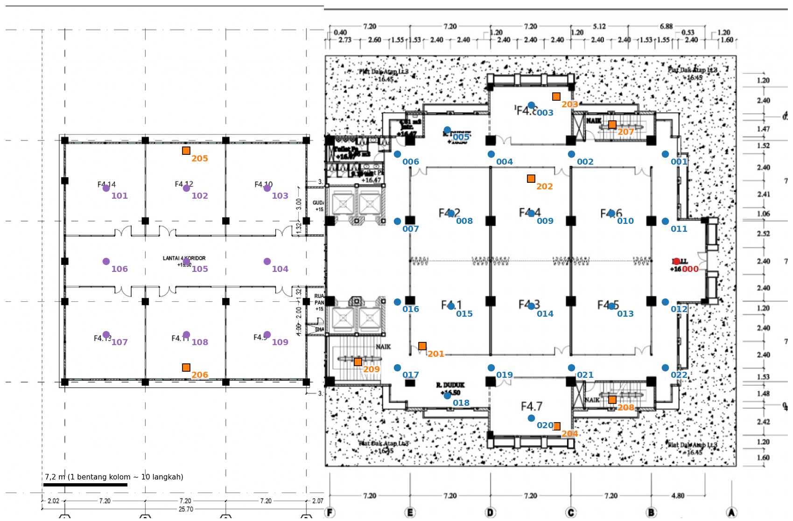

Rencana titik ukur lantai 4. Titik 207 dan 208 (tangga darurat) tidak bisa dimasuki, jadi tidak dipakai: 39 titik.

<!--
Caranya, kami menentukan titik di denah dulu, berupa grid di tengah ruang dan koridor ditambah titik-titik terjauh dari AP seperti pojok dan tangga, untuk mencari area terlemah. Di tiap titik, laptop menjalankan skrip yang membaca semua sinyal Wi-Fi tiga kali dan menyimpannya ke CSV. Lalu datanya diolah per titik.

Pendalaman. RSSI dirata-rata dalam miliwatt, bukan dBm, karena dBm logaritmik. Rata-rata −40 dan −80 kalau langsung di dBm hasilnya −60, padahal secara daya −43. Windows tidak memberikan noise floor, jadi SNR tidak bisa dihitung.
-->

---

<!-- _class: bab -->
<!-- header: "02 — Deskripsi Masalah" -->
<!-- _header: "" -->

02

# Deskripsi Masalah

Pengguna &amp; ruang, data titik ukur, cakupan, interferensi kanal, kebocoran antar-lantai, uji aktif &amp; roaming

<!--
Bagian kedua, apa yang kami temukan dari data.
-->

---

## 6 kelas, *4 AP*: dua AP kelebihan beban

Fungsi ruang &amp; user aktif

| Area | Fungsi | User saat penuh |
|---|---|---|
| F4.1–F4.6 | Ruang kuliah | 6 × 35 = **210** |
| F4.9–F4.14 (Ext) | Ruang kuliah | 6 × 35 = **210** |
| F4.7, F4.8 | *[isi fungsi ruang]* | *[isi]* |
| Hall, koridor | Menunggu, lalu-lalang | ±10–20 |

Aplikasi: LMS, slide, browsing, video/kuliah daring. 35 orang per kelas = asumsi kelompok (kapasitas 30–40 kursi), dicek dengan data Wi-Fi FILKOM di slide berikutnya.

Beban per AP · skenario berat

| AP | Melayani | Beban |
|---|---|---|
| AP-F4.4 | F4.2 + F4.4 | 126% |
| AP-F4.3 | F4.3 + F4.5 | 126% |
| AP-F4.1 | F4.1 | 63% |
| AP-F4.6 | F4.6 | 63% |

1 kelas = 35 × 1,8 Mbps (Zoom 720p) = 63 Mbps. Kapasitas efektif ±100 Mbps per AP (±35% dari link rate terukur 286,5 Mbps). Target ≤ 70%.

<!--
Lantai 4 berisi 12 ruang kuliah. Kami asumsikan saat penuh tiap kelas diisi 35 orang, jadi ada sekitar 420 pengguna. Kalau semua menonton video kuliah 720p, kebutuhan per orang sekitar 1,8 Mbps sesuai panduan resmi Zoom, jadi satu kelas butuh sekitar 63 Mbps. Satu AP kami perkirakan sanggup sekitar 100 Mbps. Masalahnya, di gedung utama ada 6 kelas tapi hanya 4 AP. AP di F4.3 sekaligus melayani F4.5, dan AP di F4.4 sekaligus melayani F4.2. Dua AP itu kelebihan beban, 126 persen. Ini dasar usulan kami, satu ruang kuliah satu AP.

Pendalaman. Skenario normal 0,6 Mbps per user, 1 AP untuk 2 kelas = 42 persen, masih aman. Kapasitas efektif 100 Mbps adalah asumsi konservatif dan bisa diverifikasi dengan iperf3. Kapasitas itu hanya berlaku kalau AP punya kanal sendiri, kalau dua AP sekanal saling dengar, kapasitasnya dibagi dua, inilah hubungannya dengan CCI. Ext juga 6 kelas dengan 4 AP, 95 persen di skenario berat, masuk rekomendasi tahap 3.
-->

---

<!-- _class: gambar -->

## Data Wi-Fi FILKOM: *perangkat per jam*

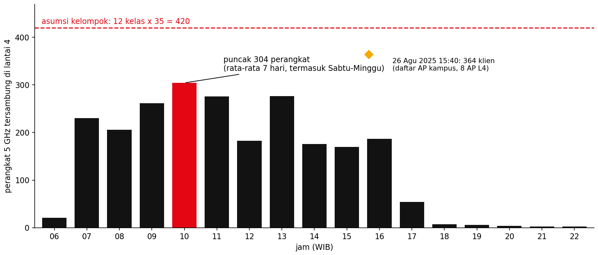

Rata-rata perangkat 5 GHz tersambung ke 8 AP lantai 4 per jam, 7 hari terakhir (website Wi-Fi FILKOM, diambil 11 Okt 2026). Karena Sabtu–Minggu ikut dirata-rata, angka hari kerja lebih tinggi. Belah ketupat = data daftar AP kampus 26 Agu 2025.

<!--
Asumsi 35 orang per kelas kami cek dengan data Wi-Fi FILKOM. Rata-rata 7 hari terakhir, lantai 4 mencapai puncak 304 perangkat pukul 10 pagi, dan sekitar 230 perangkat sepanjang jam 8 sampai 16. Angka ini sudah termasuk Sabtu dan Minggu yang hampir kosong, jadi di hari kerja angkanya lebih tinggi, kira-kira 304 × 7/5 ≈ 425 kalau akhir pekan nol. Data daftar AP kampus Agustus 2025 juga mencatat 364 klien pada jam kuliah. Jadi asumsi 420 pengguna saat penuh masuk akal, bukan angka karangan.

Catatan. Satu orang bisa membawa lebih dari satu perangkat, dan perangkat yang hanya tersambung 2,4 GHz tidak terhitung di sini.
-->

---

<!-- _class: gambar penuh -->

## Data mentah: *39 titik ukur*

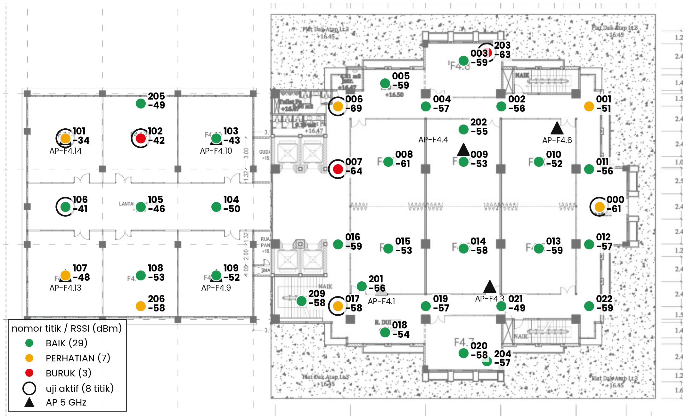

<!--
Ini data mentah kami. RSSI tiap titik adalah rata-rata 3 scan, warnanya status menurut aturan modul §4.5 (RSSI, AP cadangan, CCI, latensi, loss). Setiap titik adalah tempat kami berdiri dan men-scan. Angka atas adalah nomor titik, angka bawah adalah RSSI AP terkuat di titik itu. Warnanya status menurut aturan modul, hijau baik, kuning perhatian, merah buruk. Lingkaran hitam adalah titik-titik yang juga kami uji aktif. Dari 39 titik, 29 baik, 7 perhatian, 3 buruk. Semua heatmap dan perhitungan berikutnya berasal dari titik-titik ini.

Data lengkap per titik ada di kelompok6/output/L4_titik.csv, data mentah scan di kelompok6/data/passive_L4.csv.
-->

---

<!-- _class: gambar -->

## Heatmap RSSI *lantai 4*

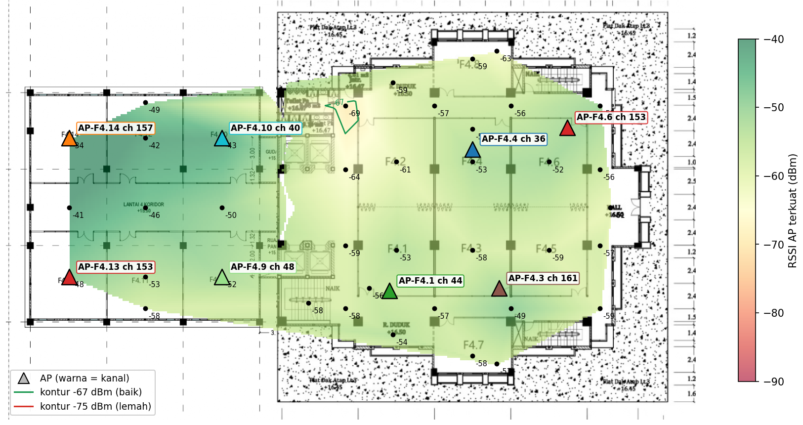

Warna = RSSI AP terkuat, diinterpolasi antar-titik ukur (hijau = kuat). Garis hijau = kontur −67 dBm. Segitiga = 8 AP 5 GHz beserta kanalnya. Area putih = tidak ada titik ukur, bukan blank spot.

<!--
Dari titik-titik tadi kami buat heatmap. Hijau artinya kuat. Garis hijau adalah batas −67 dBm, batas aman untuk video call. Hampir seluruh lantai berada di atas batas itu. Segitiga adalah posisi 8 AP 5 GHz beserta kanalnya.

Pendalaman. Warna diinterpolasi antar titik ukur, maksimal 6 m dari titik terdekat.
-->

---

## Sinyal *bukan* masalahnya

<b class="m">97,4%</b>titik ≥ −67 dBm (baik) 100% titik ≥ −70 dBm

<b>−56</b>dBm, RSSI median

<b>−69</b>dBm, titik terlemah (L4-006, pojok kiri-atas dekat toilet)

<b>0</b>blank spot (&lt; −80 dBm)

- Semua titik punya **AP cadangan ≥ −75 dBm**, jadi syarat roaming terpenuhi
- **8 AP 5 GHz, semua 20 MHz**: 4 di gedung utama, 4 di Ext

- Pojok kiri-atas (F4.2) **tidak punya AP**
- F4.3 dan F4.5 **berbagi satu AP** (AP-F4.3, di atas pintu F4.3)

Kalau sinyal bagus, kenapa masih lambat?

<!--
Hampir seluruh lantai di atas −67 dBm dan tidak ada blank spot. Area paling lemah ada di pojok kiri-atas dekat toilet, −69 dBm, karena tidak ada AP di sana. Tapi secara umum sinyalnya bagus. Pertanyaannya, kalau sinyal bagus, kenapa masih lambat?

Bukti angka ada di output/L4_ringkasan.txt dan output/L4_titik.csv kolom rssi1 dan rssi2.
-->

---

## Posisi AP &amp; *area layanan*

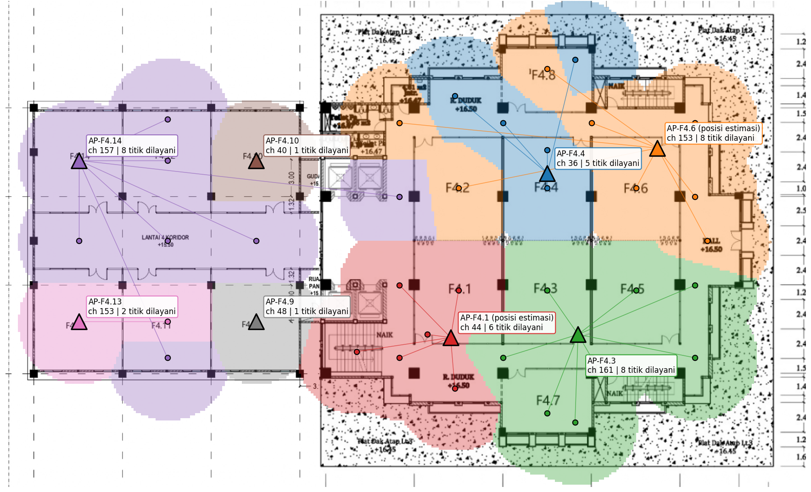

Asal posisi AP

- **Fisik, berdiri di bawah AP:** AP-F4.4, AP-F4.9, AP-F4.10, AP-F4.13, AP-F4.14
- **Pengamatan lapangan:** AP-F4.3 di dalam F4.3, di atas pintu
- **Estimasi** (3 titik terkuat): AP-F4.6, AP-F4.1

Temuan

- Titik **L4-007** di gedung utama **dilayani AP-F4.14 dari Ext**, menyeberang hall. Artinya AP Ext terlalu kuat dan ada celah AP di kiri-atas

<!--
Gambar ini menunjukkan tiap titik dilayani AP mana. Warna area sama dengan warna AP pelayannya, garis menghubungkan titik ke AP-nya. Posisi lima AP kami dapat langsung dengan berdiri di bawahnya, AP-F4.3 dari pengamatan lapangan, dan dua AP sisanya kami estimasi dari tiga titik dengan sinyal terkuat. Yang menarik, titik 007 di gedung utama justru dilayani AP Ext F4.14 dari seberang hall.

Pendalaman. Bukti AP-F4.3 di atas pintu F4.3 ada tiga, yaitu pengamatan anggota, titik L4-021 tepat di depan pintu F4.3 adalah titik terkuat AP itu (−48,8 dBm), dan nama di controller F4.3-R650. Nama AP di dokumen kami berdasarkan lokasi fisik. Peta 3D di website Wi-Fi FILKOM belum diperbarui, jadi posisi AP tetap dari survei kami sendiri.
-->

---

## 10 titik bermasalah, *6 karena CCI*

| Titik | Lokasi | RSSI | Gejala | Akar masalah |
|---|---|---|---|---|
| 000 | Hall | −61 | CCI 6, RTT 118 ms | CCI |
| 001 | Sudut koridor kanan-atas | −51 | CCI 5 | CCI |
| 101 | Ext F4.14 | −34 | CCI 3, RTT 55 ms | CCI |
| 102 | Ext F4.12 | −42 | CCI 4, loss 10% | CCI |
| 107 | Ext F4.13 | −48 | CCI 4 | CCI |
| 206 | Ext F4.11 sisi bawah | −58 | CCI 6 | CCI |
| 006 | Koridor kiri-atas (toilet) | −69 | RSSI marginal | tidak ada AP di kiri-atas |
| 007 | Koridor kiri, depan lift | −64 | loss 5%, RTT 72 ms | dilayani AP Ext dari jauh |
| 203 | F4.8 pojok | −63 | loss 5%, RTT 108 ms | jauh dari AP |
| 017 | Sudut koridor kiri-bawah | −58 | RTT 132 ms | belum jelas (sinyal baik, CCI 0) |

<b class="m">6 / 10</b>titik bermasalah karena co-channel interference, padahal sinyalnya kuat (−34 s.d. −61 dBm)

<b>1 / 10</b>titik bermasalah karena sinyal lemah (006)

Status: 29 baik · 7 perhatian · 3 buruk. Sumber: output/L4_titik.csv (kolom status &amp; penyebab).

<!--
Dari 39 titik ada 10 yang bermasalah. Kalau kita lihat penyebabnya, enam di antaranya karena co-channel interference, padahal sinyalnya kuat, bahkan ada yang −34 dBm. Hanya satu titik yang bermasalah karena sinyal lemah, yaitu 006 di pojok kiri-atas. Dua titik lagi jauh dari AP atau dilayani AP yang jauh, dan satu titik, 017, latensinya tinggi tapi sinyal dan kanalnya baik, jadi penyebabnya belum bisa kami pastikan. Jadi akar masalah utamanya adalah CCI. Apa itu CCI? Slide berikutnya.

Pendalaman. Status dihitung otomatis oleh analyze.py dengan aturan modul §4.5. PERHATIAN kalau RSSI −70 sampai −67, CCI > 2, atau latensi > 50 ms. BURUK kalau RSSI < −70 atau packet loss > 2%.
-->

---

## Temuan utama: *co-channel interference*

Cara kerja Wi-Fi (CSMA/CA)

01
Sebelum mengirim, setiap perangkat <strong>mendengarkan kanalnya dulu</strong>

02
Ada perangkat lain mengirim di kanal yang sama di atas ±−82 dBm? <strong>Wajib menunggu</strong>

03
Semua radio sekanal yang saling dengar <strong>bergiliran memakai airtime</strong>, walaupun tersambung ke AP berbeda

Sinyal kuat ≠ koneksi cepat

Akibat CCI: latensi, jitter, dan packet loss naik **walaupun RSSI tinggi**. Contoh: titik 102 sinyal −42 dBm tapi loss 10%.

Cara mengukur (modul §4.5)

CCI titik = jumlah radio lain, SSID apa pun, **di kanal AP pelayan** yang terdengar ≥ −85 dBm. **CCI &gt; 2 = bermasalah.**

<!--
Ini temuan utama kami. Di Wi-Fi, perangkat di kanal yang sama harus bergiliran bicara, dengar dulu, kalau ada yang bicara tunggu. Kalau banyak radio di satu kanal saling mendengar, waktu bicara dibagi-bagi. Akibatnya lambat walaupun sinyalnya kuat.

Analogi. Satu ruang kelas, satu spidol. Dua dosen di ruang yang sama berbagi satu spidol harus bergantian menulis, walaupun suara keduanya keras. Kalau tiap dosen punya ruang sendiri, yaitu kanal berbeda, keduanya bisa mengajar bersamaan.

Kenapa batas −85 dBm? Standar 802.11 mewajibkan menunggu kalau mendengar sinyal Wi-Fi sekitar −82 dBm untuk 20 MHz, −85 diambil sebagai margin. Catatan, RSSI titik 102 di survei pasif −42 dBm, saat uji aktif −49 dBm.
-->

---

<!-- _class: gambar penuh -->

## Bukti: spektrum di *4 titik terparah*

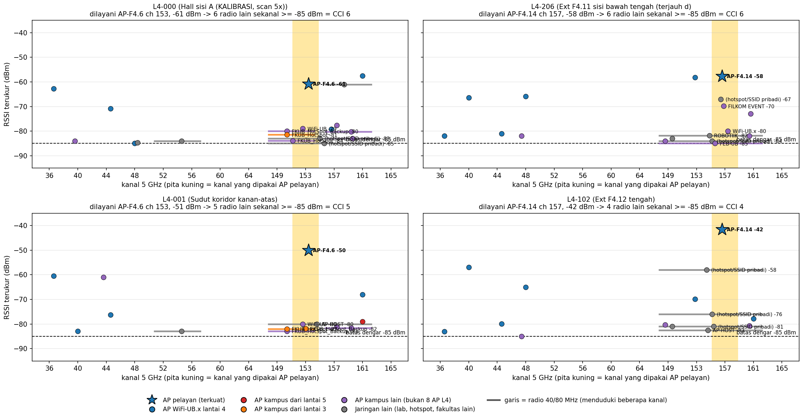

<!--
Grafik ini adalah spektrum di 4 titik terparah. Sumbu bawah adalah kanal, sumbu kiri kekuatan sinyal. Bintang adalah AP yang melayani titik itu, pita kuning adalah kanalnya. Semua titik di pita kuning di atas garis putus-putus −85 dBm adalah pengganggu. Garis horizontal adalah radio 40 atau 80 MHz yang menduduki beberapa kanal sekaligus. Contohnya di hall, titik 000, AP pelayannya AP-F4.6 di kanal 153, dan ada 6 radio lain di kanal 153 yang terdengar.
-->

---

## 43 kejadian CCI di *39 titik*

43

kejadian CCI · 6 titik CCI &gt; 2

Terparah: **hall L4-000 &amp; L4-206 (6 radio)**, L4-001 (5), L4-102 (4)

Asal 43 pengganggu

| Asal | Jumlah |
|---|---|
| Jaringan lain (lab, hotspot, fakultas lain) | **21** |
| AP kampus yang bukan 8 AP L4 (hanya eduroam/FILKOM EVENT, atau area lain) | **17** |
| AP lantai 3 | **4** |
| AP L4 lain di kanal yang sama | **1** |

CSMA/CA tidak peduli nama jaringan: semua radio sekanal harus bergiliran. Rincian 43 baris: output/solusi_L4/bukti_cci_L4.csv. Total = jumlah kolom cci di output/L4_titik.csv.

<!--
Di seluruh lantai 4 kami menemukan 43 kejadian seperti tadi. Separuhnya berasal dari jaringan lain seperti lab dan hotspot, dan sebagian besar sisanya radio kampus yang tidak memancarkan WiFi-UB.x. Radio-radio itu tidak membantu pengguna WiFi-UB.x, tapi tetap memakan airtime.

Pendalaman, asal angka 43. Jumlah kolom cci di output/L4_titik.csv yaitu 000=6, 001=5, 003=1, 008=1, 010=2, 011=2, 101=3, 102=4, 104=2, 105=2, 106=1, 107=4, 108=2, 203=1, 205=1, 206=6.
-->

---

## Tiga *kesalahan* pemilihan kanal

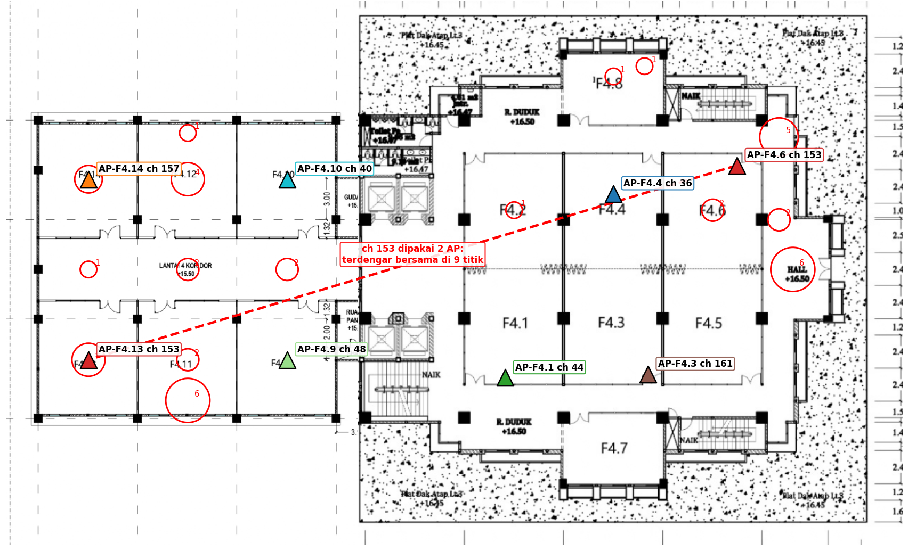

01
<strong>AP-F4.6 &amp; AP-F4.13 sama-sama kanal 153</strong> dan terdengar bersama di 9 titik

02
4 AP L4 ditaruh di <strong>kanal 149–161</strong>, kanal yang paling ramai

03
Kanal <strong>DFS 52–64 hampir kosong</strong>, tapi tidak dimanfaatkan

Lingkaran merah = jumlah radio sekanal yang terdengar di titik itu. Garis putus merah = dua AP L4 sekanal yang saling tumpang tindih.

<!--
Dari peta kanal ini ada tiga masalah pemilihan kanal. Pertama, AP-F4.6 dan AP-F4.13 memakai kanal yang sama, 153, dan terdengar bersama di 9 titik. Kedua, empat AP lantai 4 ditaruh di kanal 149 sampai 161 yang paling ramai. Ketiga, kanal DFS 52 sampai 64 hampir kosong tapi tidak dipakai.

Bukti kanal tiap AP ada di data/map_bssid_L4.csv dan data/passive_L4.csv kolom channel dan width_mhz. Bisa didemokan dengan netsh wlan show networks mode=bssid atau aplikasi WiFiAnalyzer.
-->

---

<!-- _class: gambar -->

## Data Wi-Fi FILKOM: *airtime* per AP

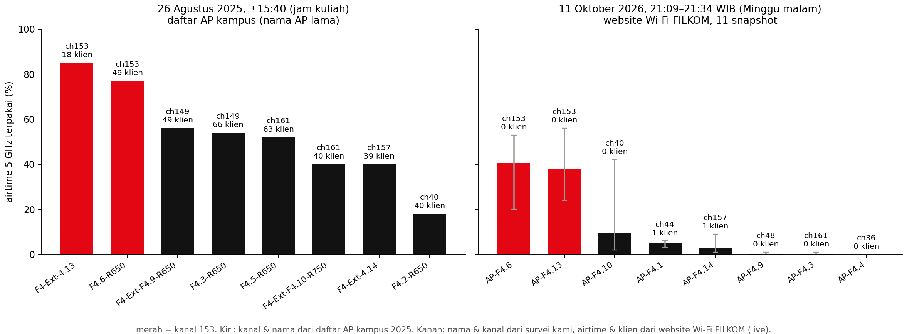

Airtime = persentase waktu kanal sibuk menurut AP. Kiri: daftar AP kampus (Agu 2025) saat jam kuliah. Kanan: website Wi-Fi FILKOM, Minggu malam (garis abu-abu = rentang antar-snapshot).

<!--
Ini data dari sisi jaringan, dari website Wi-Fi FILKOM. Airtime adalah persentase waktu kanal sibuk menurut AP itu sendiri. Batang merah adalah AP di kanal 153.
-->

---

## Kanal 153 *sibuk tanpa pengguna*

<b class="m">85%</b>airtime AP Ext F4.13 (kanal 153) dengan hanya 18 klien, jam kuliah 26 Agu 2025. AP lain 18–56%

<b class="m">±40%</b>rata-rata airtime 2 AP kanal 153 (F4.6 &amp; Ext F4.13) dengan 0 klien; 11 snapshot Minggu malam 11 Okt 2026, tidak pernah &lt; 20%

<b>≤ 10%</b>rata-rata airtime 6 AP lantai 4 lain pada saat yang sama (AP-F4.10 sempat naik sesaat)

- Tidak ada pengguna, tapi kanal sibuk: airtime itu **dipakai radio lain** di kanal 153, persis definisi CCI
- Survei kami menemukan hal yang sama: **20 radio** terdengar di kanal 153, dan AP-F4.6 &amp; AP-F4.13 saling dengar di **9 titik**

- **Dua sumber berbeda** (laptop kami &amp; data Wi-Fi FILKOM), **dua waktu berbeda** (2025 &amp; 2026), kesimpulan sama
- Rencana kanal baru memindahkan kedua AP ini ke kanal DFS 60 &amp; 56 yang kosong

<!--
Ini bukti paling kuat bahwa masalahnya interferensi kanal. Pada Minggu malam, tidak ada satu pun pengguna di dua AP kanal 153, tapi kanalnya tetap sibuk rata-rata sekitar 40 persen waktu, dan di 11 kali pengambilan data tidak pernah di bawah 20 persen. Enam AP lain di kanal berbeda rata-rata paling tinggi 10 persen. Artinya airtime kanal 153 dimakan radio lain. Pola yang sama sudah terlihat di data Wi-Fi FILKOM Agustus 2025, AP kanal 153 punya airtime tertinggi, 85 persen, padahal kliennya cuma 18. Data ini dari data Wi-Fi FILKOM, bukan dari laptop kami, jadi menguatkan temuan survei dari sisi yang berbeda.

Catatan jujur. Nama AP di daftar AP kampus 2025 belum mengikuti lokasi fisik, jadi kami membandingkan per kanal, bukan per nama. Snapshot 2026 diambil di luar jam kuliah. Untuk data jam kuliah, jalankan kelompok6/ambil_web_filkom.py --poll 5 --jam 8 di hari kerja.
-->

---

<!-- _class: gambar -->

## Kepadatan kanal &amp; *asal radio*

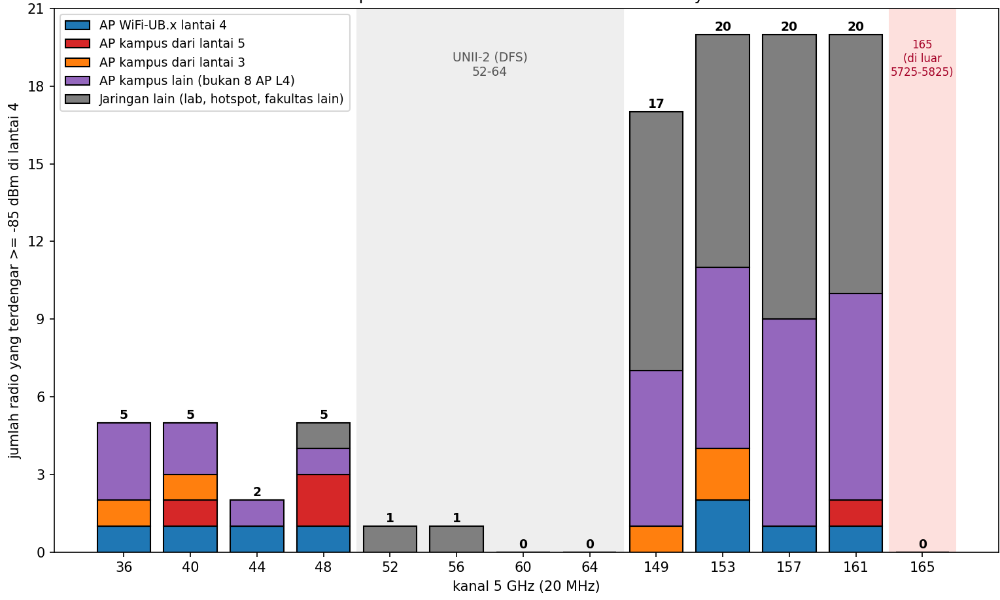

Jumlah radio 5 GHz yang terdengar ≥ −85 dBm di lantai 4, per kanal 20 MHz. Biru = AP kita, merah/oranye = AP lantai 5/3, ungu = AP kampus lain, abu-abu = jaringan lain. Radio 40/80 MHz dihitung di setiap kanal yang didudukinya.

<!--
Grafik ini menghitung berapa radio yang terdengar di tiap kanal di lantai 4, dan dari mana asalnya. Biru adalah AP kita sendiri, abu-abu jaringan lain seperti lab atau hotspot HP, ungu AP kampus lain.
-->

---

## 149–161 *penuh*, DFS *kosong*

<b>51</b>radio 5 GHz terdengar di L4. Hanya 8 yang AP WiFi-UB.x lantai 4

<b class="m">17–20</b>radio per kanal di 149–161

<b>2–5</b>radio per kanal di 36–48

<b class="m">0</b>radio di kanal DFS 60 &amp; 64 (52 &amp; 56: 1 radio lemah)

- **Kenapa 149–161 padat?** Banyak router dan hotspot memakai UNII-3 dengan lebar 80 MHz secara default. Satu hotspot 80 MHz di kanal 149 menduduki 149, 153, 157, dan 161 sekaligus
- Contoh: hotspot HP 80 MHz terdengar **−35 dBm** di Ext

- **Artinya:** kanal 149–161 adalah tempat terburuk untuk AP lantai 4, sementara kanal DFS yang sepi belum dipakai
- Ini **dasar rencana kanal baru** di bagian solusi

<!--
Kanal 149 sampai 161 sangat padat, 17 sampai 20 radio per kanal, padahal 4 AP lantai 4 ditaruh di sana. Sebaliknya, kanal 60 dan 64 kosong sama sekali. Ini dasar rencana kanal baru kami.

Pendalaman. Klasifikasi asal radio. AP lantai 3/5 kalau sinyalnya minimal 3 dB lebih kuat di lantai itu setelah koreksi offset laptop. AP kampus lain kalau memancarkan SSID kampus tapi bukan 8 AP L4. Nama SSID pribadi disamarkan untuk privasi. Daftar lengkap di output/solusi_L4/radio_L4.csv.
-->

---

<!-- _class: gambar -->

## Sinyal lantai 5 *bocor* ke lantai 4

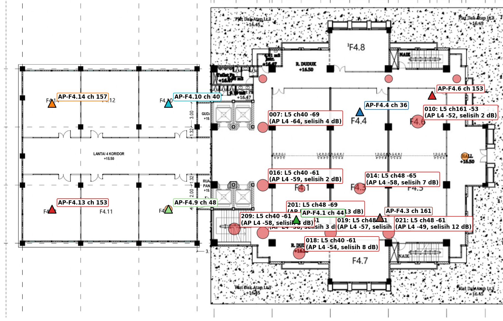

Lingkaran = sinyal AP lantai 5 (merah) dan lantai 3 (oranye) yang terdengar di titik lantai 4; makin besar makin kuat. Label = 6 titik dengan sinyal lantai lain terkuat dan selisihnya dengan AP lantai 4.

<!--
Kami juga mengukur lantai 3 dan 5 untuk melihat apakah sinyal antar-lantai saling bocor. Lingkaran merah adalah sinyal AP lantai 5 yang terdengar di lantai 4.
-->

---

## Kebocoran antar-lantai: *6 titik nyaris tersaingi*

- **10 dari 39 titik L4** mendengar AP lantai 5/3 ≥ −75 dBm
- Di **6 titik**, AP lantai 5 hanya kalah ≤ 6 dB dari AP lantai 4, jadi laptop bisa tersambung ke lantai 5. **L4-010: −53 vs −52 dBm**
- Dari lantai 3 lemah (maks. −81 dBm di L4)
- **Dampak:** AP lantai 5 ikut menanggung beban lantai 4 dan roaming makin acak. Kanal L5 yang bocor (40, 48, 161) sudah diperhitungkan di rencana kanal baru

Estimasi redaman pelat lantai

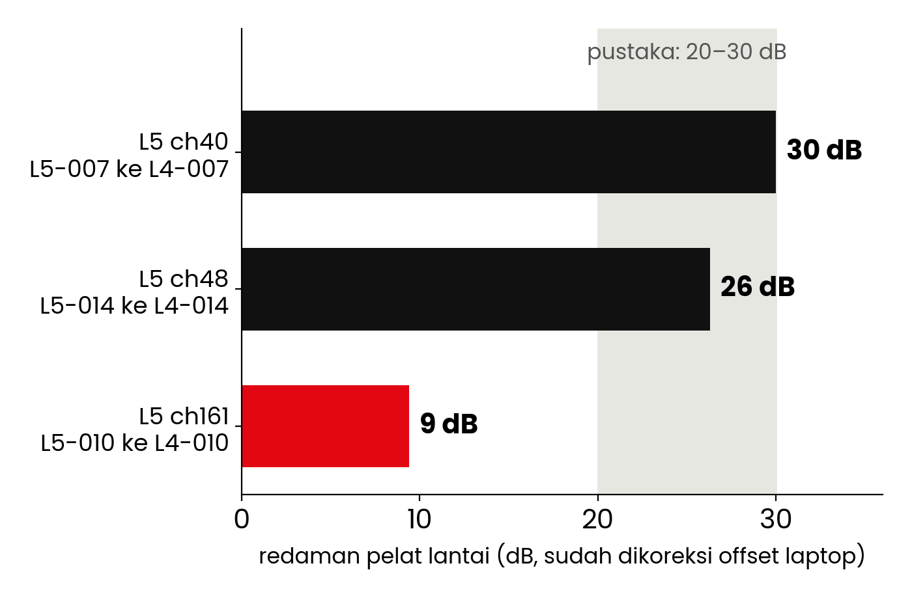

Sesuai pustaka 20–30 dB, kecuali 9 dB di atas F4.6: kemungkinan ada jalur bocor (void, tangga, shaft).

<!--
Di 6 titik, sinyal AP lantai 5 hampir sama kuat dengan AP lantai 4. Di titik 010 selisihnya hanya sekitar 1,5 dB, jadi laptop di sana bisa saja tersambung ke AP lantai 5. Redaman pelat lantai 26 sampai 30 dB, sesuai literatur, kecuali di atas F4.6 yang hanya 9 dB. Sinyal dari lantai 3 lemah, jadi tidak bermasalah.

Cara menghitung redaman. Ambil AP lantai 5 di titik L5 tempat sinyalnya terkuat, misal L5-007 −38,6 dBm setelah koreksi offset, lalu ukur AP yang sama di titik L4 tepat di bawahnya, L4-007 −68,6 dBm. Selisihnya 30 dB. Keterbatasan, L3 dan L5 hanya 13 titik, jadi nilai redaman adalah perkiraan kasar.
-->

---

## Uji aktif: sinyal kuat, *tetap loss*

Scan pasif hanya membaca kuat sinyal. Uji aktif <strong>benar-benar tersambung dan mengirim paket</strong>, jadi mengukur apa yang dirasakan pengguna saat video call.

<b class="m">5 / 8</b>titik RTT &gt; 50 ms

<b class="m">3 / 8</b>titik packet loss &gt; 2%

<b>286,5</b>Mbps link rate (Wi-Fi 6, 2 stream, 20 MHz)

| Titik | RSSI (dBm) | RTT | Jitter | Loss | Catatan |
|---|---|---|---|---|---|
| 102 (Ext) | −49 | 30 ms | 2 ms | 10% | sinyal kuat tapi loss, CCI 4 |
| 203 (F4.8) | −64 | 108 ms | 97 ms | 5% | pojok, jauh dari AP |
| 007 | −70 | 72 ms | 59 ms | 5% | dilayani AP Ext |
| 000 (hall) | −65 | 118 ms | 60 ms | 0% | CCI 6 |
| 017 | −58 | 132 ms | 76 ms | 0% | latensi tinggi |
| 101 / 106 / 006 | −43 / −53 / −65 | 55 / 42 / 39 ms | – | 0% | relatif baik |

Batas modul: RTT ≤ 50 ms, loss ≤ 2%. 20 paket per titik (loss 5% = 1 paket, indikatif). RTT diukur ke internet (Cloudflare), jadi termasuk jaringan kampus. RSSI = bacaan saat uji aktif.

<!--
Uji aktif menjawab pertanyaan, kalau sinyalnya kuat, apakah internetnya juga lancar? Scan pasif hanya membaca kekuatan beacon. Uji aktif benar-benar tersambung dan mengirim 20 paket ke server, lalu mengukur waktu bolak-balik (RTT), seberapa berubah-ubah waktunya (jitter), dan berapa paket yang hilang (loss).

Hasilnya, titik 102 di Ext sinyalnya sangat kuat tapi 10 persen paket hilang. Ini ciri khas interferensi, bukan sinyal lemah. Lima dari delapan titik punya latensi di atas 50 ms.

Catatan metode. Uji 000 dan 017 memakai TCP port 443 ke filkom.ub.ac.id karena ICMP tidak dibalas, 6 titik lain ICMP ke 1.1.1.1. Keduanya server Cloudflare, jadi sebanding. Hasil yang dipakai adalah uji ulang 11.34 sampai 11.39, uji pertama yang gagal (DNS) tidak dipakai.
-->

---

<!-- _class: gambar -->

## Uji roaming *R2*: AP tersambung &amp; ping

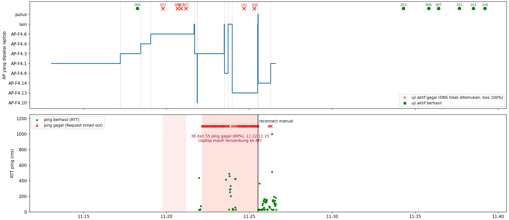

Atas: AP yang dipakai laptop dari waktu ke waktu (× merah = uji aktif gagal, ● hijau = berhasil). Bawah: hasil ping (× = gagal). Area merah = periode gangguan, garis hitam = reconnect manual.

<!--
Grafik atas menunjukkan AP mana yang dipakai laptop dari waktu ke waktu saat kami berjalan dari Ext ke gedung utama dan kembali. Setiap anak tangga adalah perpindahan AP. Grafik bawah adalah hasil ping selama berjalan.
-->

---

## Roaming: yang *terbukti* &amp; yang *belum*

Terbukti dari log

- **R1** (keliling gedung utama): pindah AP 1× (AP-F4.4 → AP-F4.3), ping putus ±4 detik
- **R2** (Ext ↔ gedung utama): pindah AP **12× dalam ±13 menit**
- **Ping-pong AP-F4.3 → AP-F4.10 → AP-F4.3 dalam 10 detik**: laptop memilih AP sendiri tanpa panduan dari jaringan
- Inilah dasar usulan **802.11k/v + min-RSSI**

Belum bisa disimpulkan

- 11:22–11:25 laptop tetap tersambung, tapi **38 dari 55 ping gagal** dan DNS gagal; normal lagi setelah **reconnect manual**
- Gejala "tersambung tanpa internet" ini **juga muncul saat survei pasif**, ketika laptop sedang scan berulang
- Hanya 1 laptop, 1 kali. Penyebab bisa jaringan (802.1X/DHCP/DNS), driver, atau aktivitas scan
- Kami catat sebagai **anomali**, bukan temuan; perlu uji ulang dengan perangkat lain tanpa skrip scan

<!--
Kami pisahkan mana yang terbukti dan mana yang belum. Yang terbukti dari log, saat berjalan dari Ext ke gedung utama laptop pindah AP 12 kali, termasuk bolak-balik AP-F4.3 dan AP-F4.10 dalam 10 detik. Ini menunjukkan laptop memilih AP sendiri tanpa panduan, jadi kami usulkan 802.11k/v dan min-RSSI.

Yang belum bisa disimpulkan, sempat ada sekitar 3,5 menit laptop tetap tersambung tapi tidak ada internet, dan baru normal setelah kami reconnect manual. Gejala yang sama juga kadang muncul waktu survei pasif ketika laptop sedang scanning. Karena hanya terjadi di satu laptop dan tidak bisa kami ulang secara terkontrol, kami tidak menyimpulkan penyebabnya. Kami catat sebagai anomali dan sarankan admin memeriksa log RADIUS dan DHCP, serta uji ulang dengan perangkat lain.

Kenapa uji roaming tetap penting? Modul meminta hasil uji roaming, dan perpindahan AP adalah pengalaman sehari-hari mahasiswa yang berjalan antar ruang.
-->

---

<!-- _class: bab -->
<!-- header: "03 — Desain Solusi" -->
<!-- _header: "" -->

03

# Desain Solusi

Kriteria, alokasi sumber daya (jumlah AP, kanal, daya), dan penempatan

<!--
Bagian ketiga, bagaimana kami merancang solusinya.
-->

---

## Kriteria dulu, *baru solusi*

| No | Kriteria | Target | Sumber |
|---|---|---|---|
| **K1** | Cakupan | ≥ 95% titik ≥ −67 dBm, tanpa blank spot | modul §4.5 |
| **K2** | Roaming | AP cadangan ≥ −75 dBm di semua titik | modul §4.5 |
| **K3** | Interferensi | CCI ≤ 2 per titik; **tidak ada 2 AP L4 sekanal yang saling dengar** | modul §4.5 |
| **K4** | Kapasitas | beban ≤ 70% pada skenario berat | perhitungan slide 9 |
| **K5** | Regulasi | kanal &amp; daya sesuai Permenkominfo 2/2023 (maks. 23 dBm, indoor) | regulasi |
| **K6** | Biaya | maksimalkan AP yang ada; ubah lewat controller dulu | praktis |

<!--
Sebelum merancang, kami tetapkan enam kriteria, yaitu cakupan, roaming, interferensi, kapasitas, regulasi, dan biaya. Semua solusi nanti diuji terhadap kriteria ini di bagian pembahasan.
-->

---

## Alokasi *sumber daya*

| Komponen | Sekarang | Usulan | Alasan |
|---|---|---|---|
| **Jumlah AP** | 8 | **10** (+AP-F4.2, +AP-F4.5) | K1: F4.2 lemah · K4: 1 kelas = 1 AP |
| **Lebar kanal** | 20 MHz | **20 MHz** | K3: kanal lebar = kanal sedikit = CCI naik |
| **Kanal** | 7 kanal, 153 dipakai 2 AP | **1 AP = 1 kanal**; 4 AP lama tetap; 3 AP pindah ke DFS | K3 |
| **Daya** | default | **AP-F4.14 −6 dB** | −34 dBm di bawah AP, bocor sampai 007 |
| **Roaming** | – | **802.11k/v/r + min-RSSI ±−72 dBm** | 12× pindah AP + ping-pong 10 detik (R2) |

<!--
Dari kriteria itu, kami mengusulkan tiga hal. Pertama, tambah dua AP, satu di F4.2 yang sinyalnya paling lemah, satu di F4.5 supaya F4.3 dan F4.5 tidak lagi berbagi satu AP. Kedua, semua AP tetap 20 MHz dan kanal ditata ulang supaya setiap AP lantai 4 punya kanal sendiri. Ketiga, turunkan daya AP Ext F4.14 sebanyak 6 dB, dan aktifkan fitur roaming.

802.11k memberi daftar AP tetangga, 802.11v menyarankan klien pindah ke AP yang lebih baik, 802.11r mempercepat login ulang WPA2/3-Enterprise saat pindah AP. Min-RSSI melepas klien yang sinyalnya di bawah ambang supaya pindah ke AP terdekat.
-->

---

## 1 AP = *1 kanal*

| AP | Lama | Baru |
|---|---|---|
| AP-F4.1 | 44 | 44 · tetap |
| AP-F4.3 | 161 | 161 · tetap |
| AP-F4.9 | 48 | 48 · tetap |
| AP-F4.10 | 40 | 40 · tetap |
| AP-F4.4 | 36 | **157** |
| AP-F4.6 | 153 | **60** · DFS |
| AP-F4.13 | 153 | **56** · DFS |
| AP-F4.14 | 157 | **52** · DFS, −6 dB |
| AP-F4.2 *baru* | – | **153** |
| AP-F4.5 *baru* | – | **36** |

Perbandingan opsi (dihitung dengan data ukur)

| Opsi | CCI | Tumpang tindih | DFS |
|---|---|---|---|
| Sekarang (8 AP) | 43 | 9 | 0 |
| +2 AP, kanal lama | 39 | 36 | 0 |
| +2 AP, kanal baru non-DFS | 12 | 32 | 0 |
| **+2 AP, kanal baru + DFS** | **2** | **0** | 3 |

Tambah AP tanpa atur kanal justru memperparah (9 → 36). Tanpa DFS, 10 AP &gt; 8 kanal, jadi pasti ada AP yang berbagi kanal. Kanal 165 tidak dipakai: di luar pita 5725–5825 MHz.

<!--
Dengan 10 AP, 8 kanal non-DFS tidak cukup, jadi 3 AP kami tempatkan di kanal DFS 52, 56, dan 60, yang di lantai 4 hampir kosong. Empat AP lama tidak perlu diubah kanalnya.

Cara rencana dicari (solusi_L4.py). Skor = CCI + titik tumpang tindih AP sekanal + 3 × AP di DFS + 1 × AP lama yang diganti. Komputer mengganti kanal satu AP sekali waktu, menyimpan kalau skor turun, diulang dari 30 titik awal acak (local search).

Rencana valid kalau semua kanal legal, tidak ada dua AP L4 sekanal, dan radio lain di kanal itu lemah. Di 5 GHz dengan 20 MHz, kanal berbeda tidak pernah tumpang tindih, beda dengan 2,4 GHz yang harus 1, 6, 11. Kalau dosen menolak DFS, pakai rencana non-DFS (CCI 12).
-->

---

<!-- _class: gambar -->

## Usulan penempatan *&amp; kanal*

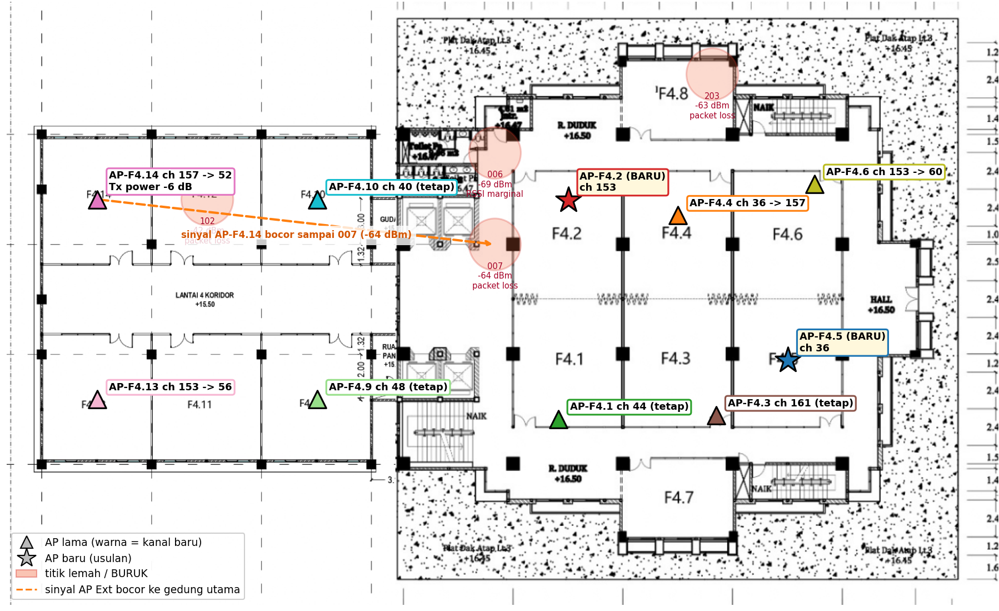

★ = AP baru. Label = kanal lama → baru (warna segitiga = kanal baru). Panah oranye = sinyal AP-F4.14 bocor sampai titik 007. Lingkaran merah = titik lemah/buruk saat ini.

<!--
Ini posisi usulan. Bintang adalah AP baru. AP-F4.2 dipasang di pojok kiri-atas yang sekarang paling lemah dan terhalang lift dan toilet. AP-F4.5 dipasang karena sekarang F4.5 menumpang AP milik F4.3. AP lama tidak perlu dipindah, dan hanya empat yang perlu diganti kanalnya lewat controller. Panah oranye menunjukkan sinyal AP Ext yang terlalu kuat sampai menyeberang ke gedung utama.
-->

---

## Kenapa *tambah 2 AP*, bukan pindah?

★
<strong>AP-F4.2 · kanal 153 → cakupan</strong> Menutup pojok kiri-atas (005–008): terlemah −69 dBm, dan 007 sekarang dilayani AP Ext

★
<strong>AP-F4.5 · kanal 36 → kapasitas</strong> F4.3 &amp; F4.5 sekarang berbagi AP-F4.3 (126%). Hasilnya: <strong>1 ruang kuliah = 1 AP</strong>

Dipasang di plafon di dalam ruang, bukan koridor (dinding bata 8–15 dB, pintu 4–6 dB), menjauhi kolom beton dan shaft lift.

7 opsi dibandingkan dengan model yang sama

| Opsi | Beban AP terberat |
|---|---|
| Pindah AP-F4.6 ke F4.2 | 126% |
| Pindah AP-F4.4 ke F4.2 | 126% |
| Pindah AP-F4.1 ke F4.2 | 189% |
| Tambah 1 AP di F4.2 saja | 126% |
| Tambah F4.2 + F4.8 | 126% |
| **Tambah F4.2 + F4.5 (usulan)** | **63%** |

<!--
Kenapa tidak memindah AP saja? Kami membandingkan 7 opsi dengan model yang sama. Memindah AP ke F4.2 memang memperbaiki pojok kiri-atas, tapi selalu ada AP lain yang jadi melayani 2 kelas, 126 persen, atau malah 3 kelas, 189 persen. Masalah kapasitas hanya hilang kalau jumlah AP sama dengan jumlah ruang kuliah.

Kenapa bukan F4.8? Sinyal di F4.8 sudah baik (003 −59, 203 −63 dBm) dan F4.8 bukan ruang kuliah utama, jadi AP di sana tidak mengurangi beban. Terlalu padat? Tidak, selama tiap AP punya kanal sendiri. Kalau anggaran hanya cukup 1 AP, prioritaskan AP-F4.2.
-->

---

## Bertahap, *mulai dari yang gratis*

Tahap 1

**Konfigurasi controller**

Ubah kanal 4 AP, turunkan daya AP-F4.14 6 dB, aktifkan 802.11k/v/r + min-RSSI

Biaya: 0

Tahap 2

**Pasang 2 AP baru**

AP-F4.2 (kanal 153) dan AP-F4.5 (kanal 36), model sama dengan AP yang ada

Biaya: 2 AP + kabel/PoE

Tahap 3

**Kondisional: +1 AP Ext**

Kalau utilisasi kanal Ext &gt; 50% saat jam sibuk, tambah 1 AP di F4.11/F4.12 (kapasitas Ext 95% di skenario berat)

Biaya: 1 AP

Feasible: gratis dulu · hanya +2 AP · sesuai regulasi · DFS sudah dipakai di lantai 3

<!--
Solusinya bertahap. Tahap pertama hanya konfigurasi controller tanpa biaya, dan justru ini yang paling berdampak ke CCI. Tahap kedua cuma dua AP. Tahap ketiga kondisional untuk Ext.

DFS legal di Indonesia untuk dalam ruangan (pita 5250–5350 MHz, Permenkominfo 2/2023), dan lantai 3 FILKOM sudah memakai kanal 52, 60, 64, jadi controller dan perangkat terbukti mendukung.
-->

---

<!-- _class: bab -->
<!-- header: "04 — Pembahasan" -->
<!-- _header: "" -->

04

# Pembahasan

Prediksi hasil, simulasi pembanding, dan justifikasi solusi

<!--
Bagian keempat, apakah solusinya benar-benar bekerja.
-->

---

<!-- _class: gambar -->

## Prediksi *sebelum vs sesudah*

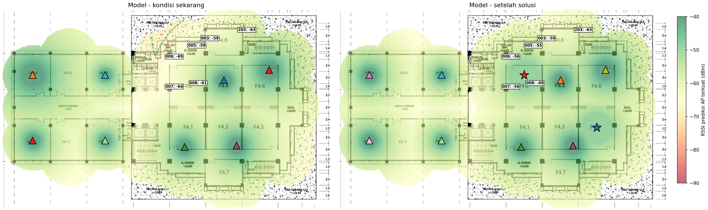

Model log-distance dari data survei sendiri: n = 2,52, RMSE 5,5 dB, tanpa redaman dinding. Sinyal AP baru dibatasi maks. −48,8 dBm (sinyal terbaik yang pernah terukur dari AP gedung utama). Kiri = kondisi sekarang, kanan = setelah solusi.

<!--
Bagaimana kami tahu solusinya berhasil? Kami membuat model penurunan sinyal dari data survei kami sendiri, lalu menghitung ulang kondisi setelah solusi.

Pendalaman. RSSI(d) = P − 10·n·log10(d). n = 2,52 cocok untuk gedung dengan koridor cincin yang cukup terbuka (ruang bebas n = 2, gedung penuh dinding 3,5 sampai 4). AP lama memakai data terukur (AP-F4.14 dikurangi 6 dB), AP baru memakai model. Hasil per titik di banding_titik_L4.csv.
-->

---

## Semua kriteria *terpenuhi* (prediksi)

<b>43 → 2</b>CCI total (metode modul) · K3

<b>9 → 0</b>titik tumpang tindih AP sekanal · K3

<b>126 → 63%</b>beban AP terberat, skenario berat · K4

<b>−69 → −63</b>dBm, RSSI terlemah · K1

- Titik ≥ −67 dBm: **97,4% → 100%** (K1)
- CCI hall (000): **6 → 0**
- Contoh titik: 006 −69 → −56 · 007 −64 → −56 · 008 −61 → −49 dBm

- **Kenapa CCI turun?** AP pelayan pindah dari kanal ramai (153/157/161) ke kanal sepi, atau titiknya dilayani AP baru di kanal tanpa pengganggu
- Sisa 2 kejadian (202 &amp; 203): radio lain yang tetap terdengar di kanal AP pelayan

<!--
Hasilnya, semua titik di atas −67 dBm, CCI turun dari 43 menjadi 2, tidak ada lagi dua AP lantai 4 yang berbagi kanal, dan setiap ruang kuliah punya AP sendiri. Tapi ini prediksi model, jadi perlu divalidasi dengan survei ulang setelah diterapkan.
-->

---

<!-- _class: gambar -->

## Simulasi pembanding: *kekuatan sinyal*

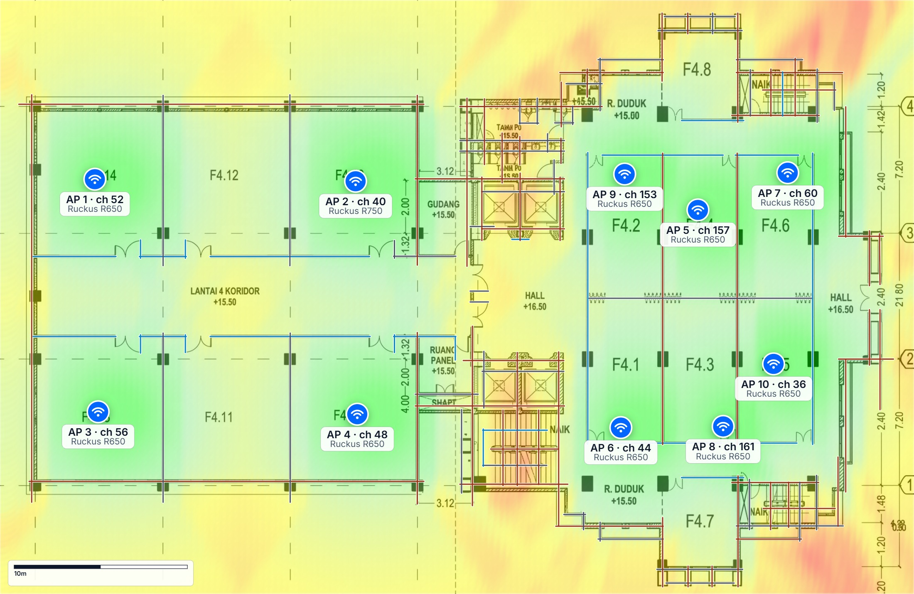

Simulasi 10 AP dengan rencana kanal usulan dan 128 dinding. Hijau ≥ −57 dBm (excellent), hijau muda −65 s.d. −57, kuning −70 s.d. −65, oranye −80 s.d. −70, merah &lt; −80 dBm.

<!--
Model kami tidak menghitung dinding. Karena itu kami juga membuat simulasi dengan perangkat lunak perencanaan Wi-Fi yang memodelkan 128 dinding, memakai 10 AP dan rencana kanal persis seperti usulan kami, yaitu satu AP per ruang kuliah di gedung utama ditambah 4 AP Ext. Label di tiap AP menunjukkan kanal usulan.
-->

---

## Simulasi *dengan dinding*: kesimpulannya sama

<b class="m">87,7%</b>area ≥ −70 dBm (dihitung dari kotak denah 53 × 34 m)

<b>10</b>AP: 9× Ruckus R650, 1× R750, kanal = rencana usulan

<b>128</b>dinding dimodelkan

<b>1.807</b>m² luas denah

Pengaturan simulasi

- Model propagasi **free-space path loss + redaman dinding**, lingkungan kantor
- Tx power 20 dBm per AP, plafon 4 m
- Klien referensi, arah downlink, ambang −70 dBm

Cara membacanya

- **Semua ruang kuliah hijau atau hijau muda** (≥ −65 dBm). Kuning/oranye hampir semuanya di hall, tangga, toilet, dan luar dinding (atap Lt. 3)
- 87,7% dihitung dari kotak 53 × 34 m termasuk area luar gedung, jadi **cakupan di dalam ruang lebih tinggi**
- Menjawab keterbatasan model kami (tanpa dinding): **10 AP cukup menutup seluruh ruang kuliah**

<!--
Simulasi memakai model free-space path loss ditambah redaman 128 dinding, Tx 20 dBm. Angka 87,7 persen terlihat lebih rendah dari prediksi kami, tapi area yang dihitung adalah seluruh kotak denah 53 kali 34 meter, termasuk atap lantai 3 di pojok gedung. Kalau dilihat petanya, semua ruang kuliah hijau. Jadi dengan dinding pun, 10 AP cukup.

Kalau ditanya kenapa versi simulasi sebelumnya 90,2 persen. Versi sebelumnya memakai model ITU-R P.1238 dan rencana kanal yang berbeda. Rencana kanal tidak mengubah kekuatan sinyal, kanal hanya menentukan interferensi. Selisih 2,5 persen itu berasal dari model propagasi yang berganti, dan terjadi di area luar ruang.

Peta data rate tidak kami tampilkan karena memakai klien referensi simulasi yang spesifikasinya berbeda dengan laptop kami, jadi angkanya tidak sebanding dengan link rate terukur 286,5 Mbps.
-->

---

<!-- _class: duagambar -->

## Simulasi: *SNR &amp; interferensi kanal*

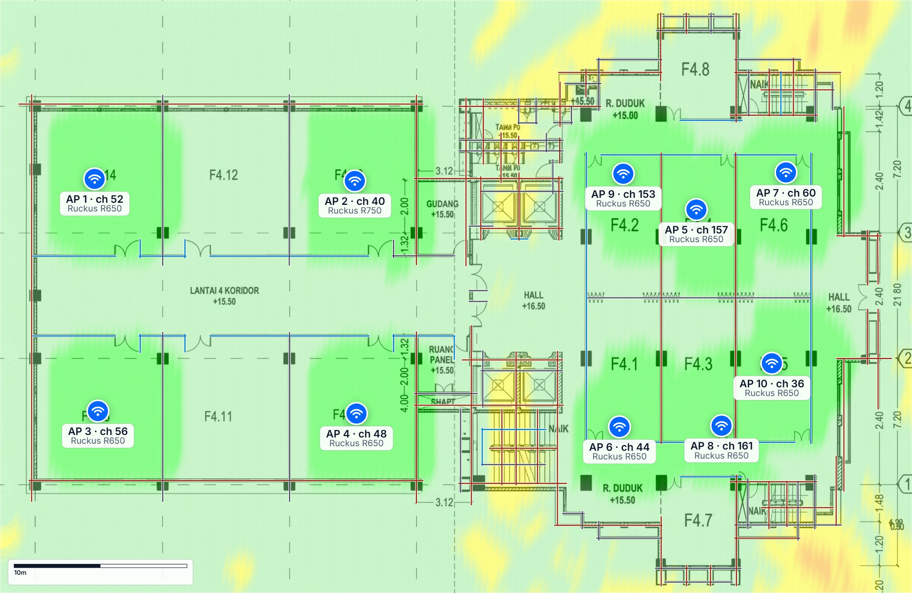

### Signal-to-noise ratio

Semua ruang hijau, kategori SNR tertinggi pada legenda simulasi (≥ 30 dB), di atas kebutuhan video ±25 dB. Kuning hanya di tangga dan shaft lift. Melengkapi data kami: Windows tidak memberi noise floor.

### Channel interference

Seluruh lantai hijau (interferensi 0–10%): dengan <strong>rencana kanal usulan</strong>, 10 AP tidak saling mengganggu. Simulasi tidak mengenal jaringan lain; dengan data ukur, sisa CCI rencana ini 2 (slide 38).

<!--
Simulasi juga memberi dua hal yang tidak bisa kami ukur. Pertama SNR, yang di semua ruang ada di kategori teratas. Kedua interferensi kanal. Dengan rencana kanal usulan kami, seluruh lantai hijau, tidak ada AP lantai 4 yang saling mengganggu. Ini konfirmasi dari alat lain bahwa prinsip satu AP satu kanal memang menghilangkan interferensi antar-AP kita sendiri.

Catatan jujur. Simulasi tidak tahu ada jaringan lain di sekitar (hotspot, lab, AP kampus lain, AP lantai 5). Karena itu kanal kami pilih dari data ukur, dan sisa CCI dari jaringan lain dihitung terpisah, hasilnya 2.
-->

---

<!-- _class: duagambar -->

## Simulasi: *kapasitas &amp; cakupan cadangan*

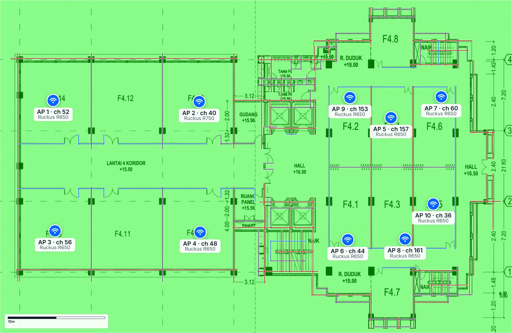

### User capacity

Seluruh lantai hijau: kapasitas ≥ 150% dari kebutuhan. Sejalan dengan hitungan kami: dengan 1 AP per kelas, beban AP terberat 63% (kapasitas ±1,6× kebutuhan, skenario berat).

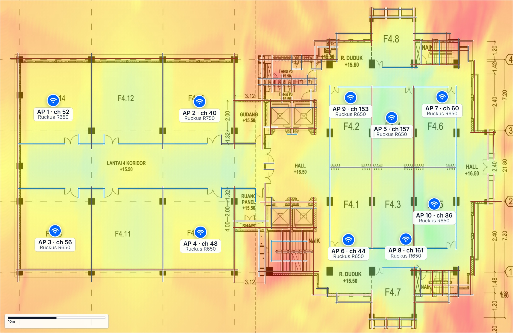

### Secondary coverage

Tengah gedung utama hijau (AP kedua ≥ −70 dBm); gedung Ext dan tepi gedung kuning–oranye, jadi AP cadangan di sana lebih lemah. Data ukur kami: semua titik punya AP cadangan ≥ −75 dBm (<strong>K2</strong>).

<!--
Peta kapasitas seluruhnya hijau, artinya dengan 10 AP kapasitas yang tersedia minimal 1,5 kali kebutuhan pengguna. Ini cocok dengan hitungan kami. Satu kelas butuh 63 Mbps di skenario berat dan satu AP sanggup sekitar 100 Mbps, jadi dengan satu AP per kelas kapasitasnya sekitar 1,6 kali kebutuhan.

Peta cakupan cadangan menunjukkan AP kedua paling kuat di tengah gedung utama. Di gedung Ext dan tepi gedung, AP cadangan lebih lemah. Data ukur kami tetap memenuhi K2, semua titik punya AP cadangan ≥ −75 dBm.

Legenda kapasitas. Hijau ≥ 150 persen dari kebutuhan, 110 sampai 150, kuning 90 sampai 110, oranye 60 sampai 90, merah di bawah 60. Legenda cakupan cadangan. Kuat ≥ −70, baik −80 sampai −70, cukup −85 sampai −80, lemah −90 sampai −85 dBm.
-->

---

## Simulasi memakai *rencana kanal kami*

| AP (simulasi) | Model sim. | Kanal sim. | Kanal usulan |
|---|---|---|---|
| AP-F4.14 (AP 1) | R650 | 52 | 52 ✓ |
| AP-F4.10 (AP 2) | R750 | 40 | 40 ✓ |
| AP-F4.13 (AP 3) | R650 | 56 | 56 ✓ |
| AP-F4.9 (AP 4) | R650 | 48 | 48 ✓ |
| AP-F4.4 (AP 5) | R650 | 157 | 157 ✓ |
| AP-F4.1 (AP 6) | R650 | 44 | 44 ✓ |
| AP-F4.6 (AP 7) | R650 | 60 | 60 ✓ |
| AP-F4.3 (AP 8) | R650 | 161 | 161 ✓ |
| AP-F4.2 *baru* (AP 9) | R650 | 153 | 153 ✓ |
| AP-F4.5 *baru* (AP 10) | R650 | 36 | 36 ✓ |

<b class="m">10 / 10</b>AP di simulasi memakai posisi dan kanal usulan kami

<b>0–10%</b>interferensi antar-AP di seluruh lantai menurut simulasi; sisa CCI dari jaringan lain menurut data ukur: 2

Dua alat berbeda, kesimpulan sama: data ukur kami (CCI 43 → 2, tumpang tindih 9 → 0) dan simulasi dengan dinding (interferensi hijau, kapasitas hijau, semua ruang kuliah tercakup).

<!--
Simulasi ini memakai posisi dan rencana kanal persis seperti usulan kami, sepuluh dari sepuluh AP. Hasilnya, interferensi antar-AP hijau di seluruh lantai, kapasitas hijau, dan semua ruang kuliah tercakup. Jadi dua pendekatan yang berbeda, pengukuran langsung dan simulasi dengan dinding, sampai pada kesimpulan yang sama.

Kalau ditanya soal versi simulasi sebelumnya. Versi awal simulasi memakai rencana kanal lain yang juga satu AP satu kanal. Kami uji dengan data ukur, CCI-nya 4 dan 6 AP lama perlu diubah, sedangkan usulan kami CCI 2 dan cukup 4 AP diubah. Karena itu simulasi akhir memakai rencana kanal kami. Hitungannya ada di output/solusi_L4/opsi_kanal_L4.csv baris "+2 AP, kanal dari simulasi".
-->

---

## Kenapa bukan *daya lebih besar* atau *80 MHz*?

<h3>Tambah daya?</h3>

- Sinyal **sudah kuat** (97,4% ≥ −67 dBm)
- Sel AP membesar, jadi **lebih banyak AP sekanal saling dengar** dan CCI naik
- **Link asimetris:** AP bisa 23 dBm, HP/laptop hanya ±15 dBm
- Klien makin **sticky** (contoh: 007 dilayani AP Ext)
- Batas legal **23 dBm** indoor

<h3>Kanal 80 MHz?</h3>

- Kanal non-DFS tidak tumpang tindih: **20 MHz = 8, 40 MHz = 4, 80 MHz = 2**
- 10 AP yang saling dengar di 2 kanal = **±5 AP per kanal**, airtime tiap AP tinggal ±1/5
- Noise naik **+6 dB** (−101 → −95 dBm)
- MCS 9 butuh sinyal **6 dB lebih kuat** (−57 → −51 dBm)

Banyak kanal sempit &gt; sedikit kanal lebar

<!--
Dua pertanyaan yang sering muncul. Kenapa tidak tambah daya? Sinyal sudah kuat, menaikkan daya memperbesar sel sehingga CCI naik, membuat link asimetris dan klien makin sticky, dan dibatasi regulasi 23 dBm. Kenapa tidak 80 MHz? Kanal non-DFS 80 MHz hanya ada 2 blok, padahal ada 10 AP yang saling dengar, rata-rata 5 AP per kanal, airtime tiap AP tinggal seperlima. Analogi jalan tol, 8 lajur kecil yang masing-masing dipakai 1 bus lebih lancar daripada 2 lajur besar yang masing-masing dipakai 5 bus bergantian.

Derau termal = −174 dBm/Hz + 10·log10(lebar), 20 MHz ≈ −101 dBm, 80 MHz ≈ −95 dBm.
-->

---

<!-- _class: bab -->
<!-- header: "05 — Kesimpulan" -->
<!-- _header: "" -->

05

# Kesimpulan

Kesimpulan, keterbatasan, dan referensi

<!--
Bagian terakhir, kesimpulan.
-->

---

## Bukan sinyal lemah, tapi *kanal terlalu ramai*

01
Cakupan sinyal lantai 4 <strong>sudah baik</strong>: 97,4% ≥ −67 dBm, tanpa blank spot

02
<strong>Masalah utama: co-channel interference.</strong> 6 dari 10 titik bermasalah, 43 kejadian, 2 AP L4 sekanal, kanal 149–161 padat, DFS tidak dimanfaatkan. <strong>Dikonfirmasi data Wi-Fi FILKOM:</strong> AP kanal 153 airtime tertinggi (85% di 2025; ±40% tanpa klien di 2026)

03
Sinyal lantai 5 bocor ke lantai 4 (6 titik nyaris tersaingi); roaming tidak terarah: 12× pindah AP termasuk ping-pong dalam 10 detik

04
<strong>Solusi:</strong> 1 AP = 1 kanal (3 di DFS), +2 AP (F4.2, F4.5), AP-F4.14 −6 dB, 802.11k/v/r. Prediksi: CCI 43 → 2, semua titik ≥ −67 dBm, beban 126% → 63%. Didukung simulasi dengan dinding

Keterbatasan

- SNR tidak terukur dari laptop; data Wi-Fi FILKOM hanya memberi SNR klien (median 47 dB se-gedung, di luar jam kuliah)
- Prediksi = model tanpa dinding; simulasi tanpa jaringan sekitar
- Posisi AP-F4.6 &amp; AP-F4.1 hasil estimasi
- 1 slot waktu survei; 20 paket per uji aktif
- Anomali "tersambung tanpa internet" belum bisa dijelaskan (1 laptop, 1 kali)
- Perlu **survei ulang** setelah implementasi

<!--
Kesimpulannya, masalah Wi-Fi lantai 4 bukan sinyal yang lemah, tapi kanal yang terlalu ramai. Solusi terpenting justru yang paling murah, yaitu mengatur ulang kanal dan memperbaiki roaming lewat controller, lalu menambah dua AP supaya setiap ruang kuliah punya AP sendiri.
-->

---

## *Referensi*

1. Modul *Hands-on: Pemetaan Kualitas Sinyal Wi-Fi 5 GHz Gedung FILKOM*
2. IEEE Std 802.11-2020, *Wireless LAN Medium Access Control (MAC) and Physical Layer (PHY) Specifications*
3. Permenkominfo No. 2 Tahun 2023 tentang Penggunaan Spektrum Frekuensi Radio Berdasarkan Izin Kelas
4. Coleman, D. &amp; Westcott, D., *CWNA Certified Wireless Network Administrator Study Guide*, Sybex
5. Cisco, *High Density Experience (HDX) Deployment Guide*
6. ITU-R P.1238, *Propagation data and prediction methods for the planning of indoor radiocommunication systems*
7. Zoom Support, *Zoom system requirements: bandwidth* (KB0060748)
8. Microsoft Learn, *Native Wifi API*
9. Website Wi-Fi FILKOM, `filkom.ub.ac.id/wifi` (API publik *recommend* &amp; *clients*, data live), diakses 11 Oktober 2026

<!--
Referensi utama adalah modul, standar IEEE 802.11, dan regulasi Permenkominfo 2/2023 untuk kanal dan daya. Angka kebutuhan bandwidth dari panduan resmi Zoom.
-->

---

<!-- _class: penutup -->
<!-- _header: "" -->

# Terima kasih

Masalahnya bukan sinyal yang lemah, tapi kanal yang terlalu ramai.

<!--
Tutup dengan kalimat kunci, lalu buka sesi tanya jawab. Persiapan jawaban ada di OUTLINE_PPT.md bagian F.
-->
